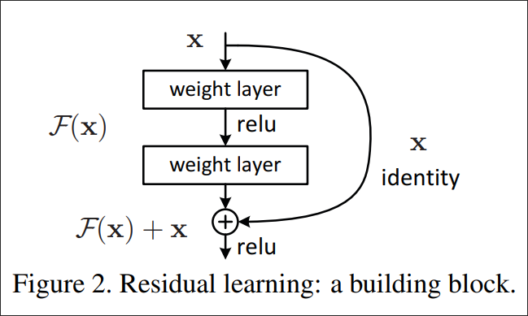

# Deep Residual Learning for Image Recognition

ResNet solved the depth limit of neural networks by adding identity skip connections so each layer block learns a residual `F(x) = H(x) - x` instead of the full mapping, winning ILSVRC 2015 with 3.57% top-5 error.

## Takeaways

if adding extra layers shouldn't (in theory) hurt a model, those layers should at least be able to learn an identity mapping. Letting a block output `F(x) + x` makes pushing the residual toward zero easy while adding no extra parameters or compute.

Residual connection is now a default building block everywhere from CNNs to Transformers.



## Citation
```bibtex
@inproceedings{he2016deep,
  title     = {Deep Residual Learning for Image Recognition},
  author    = {He, Kaiming and Zhang, Xiangyu and Ren, Shaoqing and Sun, Jian},
  booktitle = {Proceedings of the IEEE Conference on Computer Vision and Pattern Recognition (CVPR)},
  pages     = {770--778},
  year      = {2016},
  url       = {https://arxiv.org/pdf/1512.03385.pdf}
}
```
